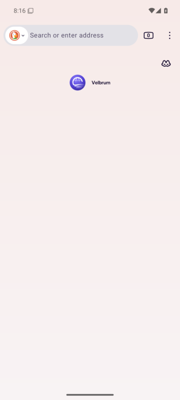
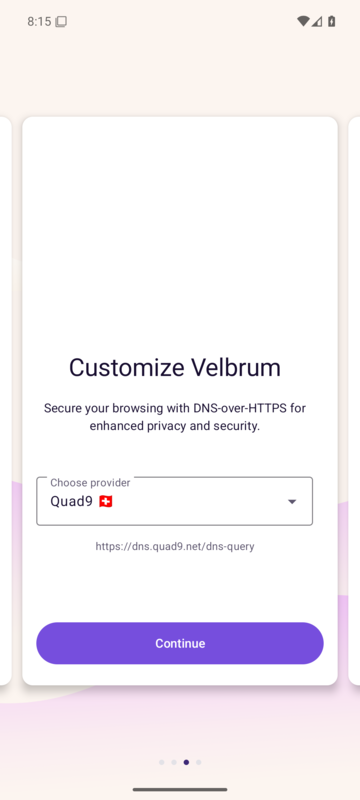
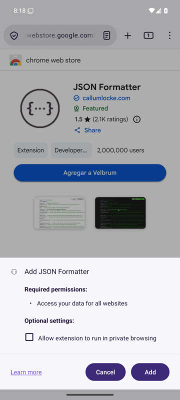

<p align="center">
  
</p>

<h1 align="center">Velbrum</h1>

<p align="center">
  <b>A private web browser for NixOS.</b><br>
  LibreWolf with Mullvad Browser's protections, Chrome extensions and a built-in Tor window.
</p>

<p align="center">
  <a href="LICENSE"></a>
  
  
  
  
</p>

<p align="center">
  <b>English</b> · <a href="README.es.md">Español</a>
</p>

<p align="center">
  
</p>

---

## Highlights

| | |
|---|---|
| 🛡️ **Mullvad-level privacy** | Letterboxing, the same fonts and language as Mullvad Browser, per-site isolation, encrypted DNS… Measured side by side with Mullvad Browser. Unlike Mullvad, sites keep the web features they expect, so pages don't break. |
| 🧅 **Tor in one click** | *New tab with Tor* in the ≡ menu or on any link. A separate private window with its own Tor, one circuit per site and a choice of exit country. |
| 🧩 **Firefox and Chrome extensions** | An **Add to Velbrum** button in the Chrome Web Store and the Edge store, plus any `.crx` file. Extensions are adapted to Gecko automatically (wallets like MetaMask and Phantom, password managers, userscript managers…), their author signature is verified, and they update daily. If there's an official Firefox version, Velbrum offers that one first. |
| ⚙️ **Velbrum button** | Security level (Standard, Safer, Safest), privacy borders, always private, light mode and signed-extensions-only, right in the toolbar. |
| 🔒 **Encrypted DNS** | DNS over HTTPS with Quad9 only, with exceptions for your local network. |
| 🪶 **Light mode** | Fewer processes and less cache for computers with little memory; turns on by itself below 4 GB of RAM. |
| 🔄 **Updates in one click** | Velbrum checks for new **signed** versions once a day and installs them if you accept (administrator password), then restarts with your tabs. Firefox security fixes arrive with every system update; nothing is compiled. |
| 📱 **Android too** | The same settings and Chrome extensions on your phone, on top of IronFox (a hardened Firefox for Android). |

> Velbrum is an independent project. It is not made or endorsed by Mozilla, LibreWolf,
> Mullvad or the Tor Project. Firefox, LibreWolf, Mullvad, Tor and Chrome are
> trademarks of their respective owners.

## Installation

### Windows, macOS and other Linux distros

Download the package for your system from the [latest release](https://github.com/ebalia-real/velbrum/releases/latest):

| System | Installer | Portable |
|---|---|---|
| Windows 10/11 | `…-windows-x86_64-instalador.exe` | `…-windows-x86_64-portable.zip` |
| macOS (Apple Silicon or Intel) | `…-macos-arm64.dmg` / `…-macos-x86_64.dmg` | `…-macos-*-portable.zip` |
| Debian, Ubuntu, Mint | `…-linux-x86_64.deb` | `…-linux-x86_64.AppImage` |
| Fedora, openSUSE | `…-linux-x86_64.rpm` | `…-linux-x86_64-portable.tar.gz` |
| Arch, Manjaro | `…-linux-x86_64.pkg.tar.zst` | |

- **Portable**: the profile lives in the `datos` folder next to the program, so
  you can carry it on a USB stick.
- **Windows** may show "Windows protected your PC" (Velbrum has no paid
  code-signing certificate): "More info" → "Run anyway".
- **macOS**: the first time, right-click Velbrum.app → Open.
- **Linux**: glibc 2.35 or newer (Ubuntu 22.04, Debian 12, Fedora 36 or later).

They are the official LibreWolf build for each system with everything Velbrum
adds: settings, branding, the Tor window (Tor included), Chrome and Edge
extensions, and on Linux the Mullvad Browser fonts. GitHub Actions builds them
for every release (`.github/workflows/paquetes.yml`): it checks the GPG
signatures of LibreWolf, Tor and Mullvad, and tests the result on all three
systems (`portable/prueba.py`). Differences from NixOS:

- **Updates**: Velbrum tells you when there's a new version and opens its page
  to download it; it doesn't install itself. Chrome extensions do update daily
  when you open Velbrum.
- **The interface language** follows the system (LibreWolf ships them all).
- **On Windows**, the Tor window uses a local port instead of a private socket
  (Windows has none), still with one circuit per site.

To build them by hand: `portable/bajar.sh`, `portable/compilar.py`,
`portable/empaquetar.py` and the scripts in `portable/linux`, `portable/windows`
and `portable/macos` (see the workflow).

### Android

Download `…-android-arm64-v8a.apk` from the
[latest release](https://github.com/ebalia-real/velbrum/releases/latest)
(`armeabi-v7a` for old 32-bit phones, `x86_64` for emulators and Chromebooks),
open it and allow your browser or file manager to install apps. Android 8 or
newer. It installs next to any other Firefox. See [Android](#android) for what
changes from the computer version.

### NixOS

Requires NixOS on x86_64 with a nixpkgs that provides `librewolf-unwrapped`,
`mullvad-browser` and `tor` (tested with NixOS 26.05).

1. Put this folder next to your `configuration.nix`:

   ```bash
   sudo git clone https://github.com/ebalia-real/velbrum /etc/nixos/velbrum
   ```

2. Import the module in `configuration.nix`:

   ```nix
   imports = [ ./velbrum/modulo.nix ];
   ```

3. Apply the configuration:

   ```bash
   sudo nixos-rebuild switch
   ```

Optional settings, also in `configuration.nix`:

```nix
# Only extensions signed by Mozilla, fixed for every user (no Chrome extensions).
velbrum.extensionesDeChrome = false;
# Domains resolved by the system DNS instead of encrypted DNS: your local
# network and, if you use a VPN with its own names, that VPN's domains.
velbrum.dominiosLocales = [ "lan" "home" "home.arpa" "internal" "localdomain" ];
```

The interface follows the system language (`i18n.defaultLocale`); web pages see
`en-US`, like every Mullvad and Tor user.

## Using Velbrum

<table>
  <tr>
    <td width="50%"></td>
    <td width="50%"></td>
  </tr>
  <tr>
    <td align="center"><sub>≡ menu → <i>New tab with Tor</i></sub></td>
    <td align="center"><sub>The Tor window, confirmed by check.torproject.org</sub></td>
  </tr>
</table>

- **Open it** from your applications menu: **Velbrum**. Right-clicking its icon
  offers *New window*, *New private window* and *New private window with Tor*.
- **Velbrum button** (the Velbrum symbol in the toolbar) opens Velbrum's own settings:
  - **Security level**: *Standard*, *Safer* or *Safest*, like Mullvad Browser;
  - **Privacy borders** (letterboxing), on or off instantly;
  - **Always private, like Mullvad**: no history, cookies or cache are kept
    (your extensions keep working: Velbrum allows them in private windows);
  - **Light mode** for computers with little memory;
  - **Only extensions signed by Mozilla**;
  - **New tab with Tor**.
- **Tor from the ≡ menu**: *New tab with Tor*, right below *New private window*;
  and on any link, right-click → *Open link in a tab with Tor*.
- **From a terminal**: `velbrum`, `velbrum https://example.com`, `velbrum --privada`,
  `velbrum --tor`. `velbrum --ayuda` lists every option.

Velbrum's own labels (the Velbrum button, its menu items and the terminal options)
are in Spanish for now; the rest of the browser follows your system language.

## Tor window

A separate Velbrum window that reaches the internet through the Tor network:
websites see a Tor address instead of yours, and your internet provider only
sees that you use Tor. If the Tor window is already open, a new tab is added
there. It can't be a Tor tab inside a normal window: it would share cookies and
fingerprint with your other tabs.

- **Separate from your normal Velbrum**: its own profile, always private (nothing
  remains when you close it), without your cookies or history.
- **Its own Tor**: started only for that window and stopped when you close the
  last one; no background service using memory. It listens on a socket that only
  your user can open. Velbrum waits for Tor to connect (the first time can take a
  minute) and opens check.torproject.org to confirm it.
- **One circuit per site**, like Tor Browser: each site sees a different Tor
  address, so they can't be linked by IP.
- **Exit country** (Velbrum button in that window, or `velbrum --tor-pais de`):
  *Automatic* (the most anonymous) or Germany, the Netherlands, the United
  States, Sweden, Austria, France, Norway, Switzerland, Romania, Finland,
  Iceland, Denmark or Luxembourg — the countries with enough Tor exit relays.
  It applies instantly and is remembered. *New circuits* changes the address
  without changing the country. It's the closest thing to a free, account-less
  VPN with countries: with a VPN you trust a company; with Tor, that three
  volunteer relays don't collude. Choosing a country makes you a bit easier to
  tell apart than *Automatic*, and Tor is slower than a VPN.
- **Locked down**: DNS through Tor, no WebRTC or HTTP/3, privacy borders always
  on, no store extension (its converter doesn't go through Tor) and no
  extension installs.

> **It is not Tor Browser.** Websites see Velbrum's fingerprint (Firefox 156 with
> *resistFingerprinting*), not Tor Browser's, which is identical for millions of
> people. It hides your IP, but if you need real anonymity (journalism, real
> danger), use Tor Browser. Some websites block Tor or show captchas.

## Privacy

Velbrum starts from LibreWolf, which already brings fingerprinting resistance
(*resistFingerprinting*), strict tracking protection, uBlock Origin, HTTPS-Only
mode, Global Privacy Control, no telemetry, no Google Safe Browsing, no password
manager or DRM, and clears cookies and cache on exit.

On top of that it adds what Mullvad Browser does and LibreWolf doesn't:

| Feature | What it does |
|---|---|
| Privacy borders (*letterboxing*) | The page area is rounded to common sizes (e.g. 1200×600 instead of 1323×683); the borders you see are what's left over. Your exact window size, which helps identify you, never reaches websites. |
| Pages in English | Websites see `en-US`, like every Mullvad and Tor user; Velbrum's interface stays in your language. |
| Mullvad Browser's fonts | Pages only see the fonts shipped with Mullvad Browser, with the same font for each language, not the ones on your computer. |
| Encrypted DNS (Quad9) | Your internet provider can't see which sites you visit. Quad9 also blocks malware domains. |
| Per-site isolation | Cookies, cache, connections and storage are kept separate per site (Firefox's Total Cookie Protection and network partitioning). The Tor window also adds Tor Browser's first-party isolation. |
| Features that reveal nothing | Geolocation exists but has no source (no network service, GeoClue or GPS). Passkeys, service workers, SharedArrayBuffer (isolated sites only) and WebGL 2 work as in Firefox, so sites that assume them don't break. No push notifications or MIDI. The Tor window turns all of them off, like Tor Browser. |
| WebRTC without local addresses | No local or VPN addresses leak. Calls connect as in Firefox (Mullvad only allows relayed calls, which breaks Discord and WhatsApp Web calls). |
| Fingerprint | Fixed storage quota, no system colors or accent color, no TLS session identifiers. |
| No calls home to Mozilla | No push, no video plugins (Widevine/OpenH264), no remote fingerprinting overrides. |
| Proxy can't be bypassed | With the Tor window or a VPN, neither extensions nor a proxy failure make it connect directly. |
| **Security level** | *Standard*: everything works. *Safer*: no JavaScript JIT or WebAssembly, some fonts and math symbols off, audio and video play on click. *Safest*: also no JavaScript, SVG, WebGL or downloaded fonts. Like Mullvad, but with Gecko preferences instead of NoScript. |
| **Always private** (optional) | What Mullvad always does: no history, cookies or cache are written to disk. |

Where Velbrum is stricter than Mullvad: Firefox's tracking protection stays on
(Mullvad turns it off), certificate revocation (CRLite) stays on, and WebGL asks
for permission on each site, like LibreWolf. Where it's more compatible: Mullvad
removes some web features entirely, and sites that take them for granted fail to
load (metamask.io without WebGL 2, Google and Microsoft sign-ins without
`navigator.credentials`, WhatsApp Web without service workers). Velbrum keeps
them, the same as regular Firefox, so having them doesn't make you stand out
among Firefox users. Tested against 40 demanding sites (wallets and exchanges,
Google, Microsoft, WhatsApp, Discord, Zoom, Figma, Notion, Spotify…): they load
the same as in Firefox, with no errors from missing features.

<details>
<summary><b>Test results</b></summary>

Measured with Velbrum opened normally (automation tools disable part of the
protection), with a Spanish interface and pages in English:

- **EFF Cover Your Tracks**: "strong protection against Web tracking"; blocks
  tracking ads and invisible trackers; randomized canvas fingerprint.
- **BrowserLeaks WebRTC**: no leak, no local IP visible (nor a VPN's).
- **BrowserLeaks JavaScript**: UTC time zone (`Atlantic/Reykjavik`), `en-US`,
  no client hints, Global Privacy Control on.
- **BrowserLeaks Canvas**: the canvas fingerprint changes every session.
- **CreepJS**: 1200×900 screen (the letterboxed one, not the real one), only 7
  detectable fonts (Mullvad's), noisy canvas, WebGL blocked until you allow it.
- **ipleak.net**: websites see Quad9's DNS servers, not your provider's.
- **Side by side with Mullvad Browser 15.0.23** (same test page in both): same
  language, time zone, core count, screen and window size, pixel ratio, visible
  fonts, font metrics, audio fingerprint, GPC, PDF viewer and storage quota.
  Velbrum also exposes geolocation (without a source), passkeys, service workers
  and WebGL 2, like Firefox, for compatibility. Of the 246 privacy preferences where Velbrum used to differ from
  Mullvad, only the intentional ones remain. Remaining differences, inherent to
  Firefox 156 versus Mullvad's 140 (no preference changes them): the Firefox
  version, touch points (5 vs 0) and the `Accept-Language` format (`q=0.9` vs
  `q=0.5`).
- **Tor window**: check.torproject.org says "Congratulations. This browser is
  configured to use Tor"; three different sites came out through three
  different Tor addresses; WebRTC doesn't exist in pages; proxy, DNS and private
  mode are locked; choosing a country moved the exit to that country (Germany,
  the Netherlands, the United States, according to the Tor directory); Tor stops
  when the last Tor window closes.

Cover Your Tracks still says "nearly unique fingerprint": that happens to every
browser with *resistFingerprinting* (Mullvad and Tor too), because few people in
its database share those values.

</details>

## Chrome and Edge extensions

- In the [Chrome Web Store](https://chromewebstore.google.com) and the
  [Edge store](https://microsoftedge.microsoft.com/addons), the store button
  reads **Add to Velbrum**: click it and confirm in Firefox's install dialog. The
  "switch to Chrome/Edge" banners disappear.
- **If there's an official Firefox version**, Velbrum offers it before
  converting: a notice with **Install the Firefox version** (downloaded from
  [addons.mozilla.org](https://addons.mozilla.org), signed by Mozilla, and
  updated automatically like in Firefox) or **Convert the Chrome one anyway**.
  This covers MetaMask, Phantom, Bitwarden, 1Password, LastPass, Dashlane, Proton
  Pass, Grammarly, Honey, Dark Reader, Stylus, Violentmonkey, Tampermonkey,
  SponsorBlock, Wappalyzer, React Developer Tools, Adblock Plus and more (the list
  is in `extension/equivalentes.json`). The Firefox version can be installed even
  with signatures required.
- **Any `.crx` file** you download: when the download finishes, Velbrum shows a
  notification; click it and confirm. A `.crx` opened from your file manager
  installs the same way.
- **From a terminal**: `velbrum --extension-chrome <ID, store URL or file.crx>`.
- **Daily updates** from the store each extension came from; never to an older
  version, and never with new permissions without asking you.

Chrome and Firefox extensions share almost the same API (WebExtensions). Velbrum
downloads the extension, verifies its author signature (CRX3, like Chrome),
adapts it and installs it: the Chrome background service worker becomes a Gecko
background page that stays alive, the extension's own pages talk to it through
an emulated `navigator.serviceWorker` (`clients`, `postMessage`, message
ports), missing APIs are emulated (`chrome.offscreen`, `chrome.sidePanel`,
`runtime.getContexts`, `storage.managed`, `runtime.lastError`…), content scripts
get Chrome's behavior where Gecko differs (`window.chrome`, `CustomEvent`
details pages can read, injected CSS that loses to the page's own), rules and options Gecko rejects are dropped, and
whatever Gecko doesn't accept is removed from the manifest. When this layer
improves, installed extensions are converted again with the next daily update.

Tested with 26 extensions known to cause trouble outside Chrome: MetaMask,
Phantom, Rabby, Coinbase Wallet, Trust Wallet, OKX Wallet, Bitwarden, 1Password,
LastPass, Proton Pass, Dashlane, Grammarly, Honey, Adobe Acrobat, Adblock Plus,
uBlock Origin Lite, Dark Reader, Stylus, Tampermonkey, Violentmonkey,
SponsorBlock, Video Speed Controller, Wappalyzer, React Developer Tools, Loom
and Google Translate. All of them install and start; wallets inject
`window.ethereum` and `window.solana` into pages. What Gecko simply doesn't have
can't work (screen recording in Loom, for example). If an extension also has a
Firefox version on addons.mozilla.org, that one is still the best choice, which
is why Velbrum offers it first.

Mozilla can't sign Chrome extensions, so Velbrum accepts unsigned extensions —
always through Firefox's confirmation dialog. To accept **only Mozilla-signed
extensions**, tick that box in the Velbrum button (Chrome extensions are disabled,
not deleted) or set `velbrum.extensionesDeChrome = false` to lock it system-wide.

<details>
<summary><b>Security of the extension converter</b></summary>

- **Nothing installs without your confirmation.** Anything dropped into the
  profile, `~/.mozilla/extensions` or system folders stays disabled until you
  approve it, and that rule is locked.
- **Install requests** are only accepted from the two stores' pages (main frame)
  and only after a real click of yours; a page script can't click for you.
- **Native host**: only Velbrum's extension can talk to it; it validates IDs and
  paths and never uses a shell.
- **Downloads**: HTTPS to each store's servers, the hash announced by the store,
  the author's CRX3 signature and a signed ID that matches the requested one.
  Huge files, zip bombs and path traversal (`..`, absolute paths) are rejected.
- **Firefox versions**: only the ones in `extension/equivalentes.json` (a page
  can't ask for another), over HTTPS from addons.mozilla.org, with the hash its
  API announces; Firefox checks Mozilla's signature when installing.
  `python3 -I pruebas/equivalentes.py` checks the table against AMO and both
  stores.
- **File permissions**: the profile and converted extensions live in folders only
  your user can read (700).
- **Not covered**: like in any browser, a program already running as your user
  can modify your profile; with signatures required, Firefox demands Mozilla's
  signature in that case too.

Run the converter's security tests (needs internet) from Velbrum's folder:

```bash
python3 -I pruebas/seguridad.py
```

</details>

## Android

<table>
  <tr>
    <td width="33%"></td>
    <td width="33%"></td>
    <td width="33%"></td>
  </tr>
  <tr>
    <td align="center"><sub>Home screen</sub></td>
    <td align="center"><sub>Encrypted DNS with Quad9</sub></td>
    <td align="center"><sub><i>Add to Velbrum</i> in the Chrome Web Store</sub></td>
  </tr>
</table>

Velbrum for Android is the official build of [IronFox](https://ironfoxoss.org)
(a privacy-hardened Firefox for Android, the successor of Mull) with Velbrum's
name, icons, settings and store extension. LibreWolf has no Android version, and
compiling Firefox for Android takes hours and tens of GB per release, so nothing
is compiled: GitHub Actions (`.github/workflows/android.yml`) downloads IronFox's
APKs, accepts them only if they're signed with IronFox's certificate (pinned in
`android/versiones.env`; IronFox publishes no GPG signatures), changes the
resources and Gecko's configuration with `android/reempaquetar.py` (the app's
code is untouched), signs them with Velbrum's key and tests them in an emulator
with `android/prueba.py`: clean install, branding, Quad9, and a Chrome Web Store
extension converted and installed. Its app ID is `io.github.ebalia_real.velbrum`.

Like on the computer:

- **The same settings**: `gecko/ajustes.cfg` plus `android/ajustes-android.cfg`
  on top of IronFox's own hardening. `resistFingerprinting`, DNS over HTTPS with
  Quad9 (offered by default in the welcome screens, with maximum protection),
  WebRTC without local IPs, no background connections to Mozilla.
- **Chrome and Edge extensions**: the store button reads **Add to Velbrum**. The
  extension is converted inside the browser (`android/extension/convertir.js`:
  the same steps and tables as `host/extensiones_chrome.py`, with the author's
  CRX3 signature and the store's hash checked) and installed through Android's
  install dialog. If there's an official Firefox version, it's offered first.
  Manifest V3 extensions get the sites they ask for when you accept the dialog,
  as in desktop Firefox (IronFox doesn't grant them).

What changes:

- **Installing add-ons is off at first** (an IronFox security switch). Turn it on
  in Settings → Velbrum → Velbrum settings → Security → *Allow installation of
  add-ons*; the browser restarts. Velbrum tells you where it is the first time
  you try to add an extension.
- **No built-in Tor window**: use [Orbot](https://orbot.app) (VPN mode) or Tor
  Browser for Android.
- **Converted extensions don't update by themselves**, and downloaded `.crx`
  files can't be opened: to update one, tap *Add to Velbrum* again in its store.
- **No Velbrum button**: security level, letterboxing (it does nothing on a
  phone) and light mode don't apply; the rest is in the app's settings.
- **`resistFingerprinting`** is on, as on the computer and in Tor Browser.
  IronFox prefers Firefox's fingerprinting protection because a few sites break;
  if one does, `privacy.resistFingerprinting` can be turned off in
  `about:config`.
- **Updates**: each Velbrum release brings new APKs built on the IronFox version
  in `android/versiones.env`. Android installs them over the previous one
  because they're signed with the same key. [Obtainium](https://obtainium.imranr.dev)
  can follow the GitHub releases.

The APKs are signed with Velbrum's own key. Its certificate's SHA-256 is
`VELBRUM_CERTIFICADO` in `android/versiones.env`; `reempaquetar.py` refuses to
finish if a release is signed with any other key. To check a download:
`apksigner verify --print-certs velbrum-….apk`.

<details>
<summary><b>Building the APK by hand</b></summary>

Needs apktool, `rsvg-convert` (librsvg), ImageMagick, Java and the Android
build-tools (`zipalign`, `apksigner`) in the `PATH`.

```bash
android/bajar.sh descargas arm64-v8a
python3 -I android/reempaquetar.py --apk descargas/ironfox-*-arm64-v8a.apk --salida velbrum.apk --clave ~/.ssh/velbrum-android.p12
```

`apksigner` asks for the key's passphrase (or reads it from the
`VELBRUM_ANDROID_FRASE` variable, as in GitHub Actions).
Without `--clave` the APK is signed with a throwaway test key: fine for an
emulator, not for publishing. To test it, with an emulator running (Android 15,
`pixel_6` device): `python3 android/prueba.py --apk velbrum.apk`.

For GitHub Actions to sign releases, the key goes into two repository secrets:
`VELBRUM_ANDROID_FIRMA` (the `.p12` file in base64) and `VELBRUM_ANDROID_FRASE`.
Without them, a tag fails instead of publishing APKs signed with a test key.

IronFox is MPL-2.0; its Gecko configuration (Phoenix, inside the APK's
`omni.ja`) is GPL-3.0, and its sources are at
[gitlab.com/ironfox-oss/IronFox](https://gitlab.com/ironfox-oss/IronFox).

</details>

## Light mode

For computers with little memory: tick *Light mode* in the Velbrum button; it turns
on by itself below 4 GB of RAM. It uses fewer processes and less cache, doesn't
keep previous pages in memory, and unloads tabs you aren't using when memory runs
low. Site isolation (Fission) stays on: it's an important security protection.

Measured with a used profile (PSS of all processes): about 710–980 MB with two
light tabs and about 1.6 GB with six heavy ones (YouTube, Reddit, news sites).
With 2 GB of RAM Velbrum works well with a few tabs (better with a light desktop
such as XFCE or LXQt); with 1 GB no modern browser is comfortable.

## Updates

- **New versions of Velbrum**: once a day Velbrum looks for a new version on
  GitHub. If there is one, a bar offers **Install and restart** or **Not now**.
  Installing asks for the administrator password; the `velbrum-actualizar` helper
  downloads the version, checks that it is **signed with Velbrum's key** (the
  public key comes from the installed package, not from the download), moves
  the Velbrum folder to that version and rebuilds the system. Then **Restart now**
  reopens Velbrum in the new version with your tabs. Velbrum button → *Buscar
  actualizaciones* checks right away.
- **After your own rebuilds** (for example `nix flake update` for Firefox
  security fixes), Velbrum notices the new version and offers to restart.
- **Requirements**: the Velbrum folder is a git clone (as in
  [Installation](#installation)) without local changes. The default command is
  `nixos-rebuild switch`, which on flake systems uses `/etc/nixos`.
- **Settings**:

  ```nix
  velbrum.actualizador.buscar = false;                       # don't contact GitHub
  velbrum.actualizador.repositorio = "ebalia-real/velbrum";    # where versions come from
  velbrum.actualizador.carpeta = "/etc/nixos/velbrum";         # the git clone to update
  velbrum.actualizador.comando = "/run/current-system/sw/bin/nixos-rebuild switch";
  ```

- **Security**: only `vYYYY.MM.DD` tags signed with a key listed in
  `firmas/claves-permitidas` are installed, and the tag must match its
  `VERSION` file. Git runs as the folder's owner, never as root, with hooks
  disabled, so the repository's git settings and hooks never run as
  administrator; the rebuild does (it applies Velbrum's Nix code, which is
  what the signature vouches for). If the folder has local changes, nothing is
  touched. Log: `/var/log/velbrum-actualizar.log`.
- **Keep the folder owned by root.** If it belongs to your user, any program
  running as you can change it between the signature check and the rebuild (or
  before any `nixos-rebuild` of yours), and that code would run as root.

<details>
<summary><b>Publishing a version (maintainers)</b></summary>

1. Bump `VERSION` (for example `2026.10.22`, or `2026.10.22.1` for a second
   one that day) and commit.
2. Create a tag signed with the release key (the one in `firmas/claves-permitidas`):

   ```bash
   git -c gpg.format=ssh -c user.signingkey=~/.ssh/velbrum-firma.pub tag -s v2026.10.22 -m "Velbrum 2026.10.22"
   ```

3. Push the commit and the tag: `git push origin main v2026.10.22`.

Whoever holds the release key can publish an update that every Velbrum
installs as root: protect it with a passphrase (`ssh-keygen -p -f
~/.ssh/velbrum-firma`) or use a hardware key (`ssh-keygen -t ed25519-sk`), and
keep it off the machine that holds your GitHub credentials if you can.

</details>

## What Velbrum can't hide

No browser is fully private. Velbrum protects what happens inside the browser, but:

- **Your IP is visible** in normal windows (and with it, your provider and
  approximate city). Use the Tor window, a VPN or Tor Browser to hide it.
- **Accounts**: if you sign in somewhere, that site knows it's you.
- **Extensions**: every extension changes your fingerprint, and one with access
  to all sites can read the pages you open.
- **Automatic connections**: the Mozilla services LibreWolf keeps (block lists,
  certificate revocation, add-on updates); once a day, GitHub to look for a new
  version of Velbrum (it sees your IP; `velbrum.actualizador.buscar = false` turns
  it off); and once a day, the Chrome or Edge store to look for updates of your
  Chrome extensions (they see your IP and those extensions' IDs; with signatures
  required this check doesn't run).
- **Fingerprint**: it matches Mullvad Browser except the Firefox version and two
  details that depend on it — enough for a site to tell you aren't using Mullvad
  or Tor Browser, and Velbrum users are few.
- **On your computer**, history is kept (cookies and cache are cleared on exit)
  unless *Always private* is on. Private windows and the Tor window keep nothing.

## Tweaks

In `about:config`:

| To… | Set |
|---|---|
| See pages in your language (makes you easier to tell apart) | `privacy.spoof_english` → `1` |
| Use WebGL without being asked | `librewolf.webgl.prompt` → `false` |
| Be as strict as Mullvad (some sites and extensions break) | `privacy.firstparty.isolate` → `true`, `security.webauth.webauthn` → `false`, `dom.serviceWorkers.enabled` → `false`, `geo.enabled` → `false`, `media.peerconnection.ice.relay_only` → `true` |

Permanent personal settings go in a `user.js` file in `~/.local/share/velbrum/gecko/`.

<details>
<summary><b>Branding and language</b></summary>

Velbrum uses LibreWolf's engine, but LibreWolf doesn't show up inside the
browser: the logo, icons, new tab page, *About Velbrum*, settings, help menu and
`about:support` all say Velbrum. This is done at build time by replacing files
inside LibreWolf's `omni.ja` (`marca/textos.py` and `marca/codigo.py`). The
browser doesn't contact LibreWolf's servers either: uBlock Origin downloads its
filter list index from its own sources.

Mozilla's language packs say "Firefox", so the `velbrum-idioma` system service
downloads the pack for your language and version, rebrands it as Velbrum and
stores it in `/var/lib/velbrum/idioma` (only root can modify it); a browser policy
installs it from there. Without internet Velbrum opens in English and the service
retries every 10 minutes.

If a LibreWolf update changes something this relies on, the build prints a
warning (`AVISO`) without failing the system rebuild.

</details>

<details>
<summary><b>Where things are</b></summary>

| What | Where |
|---|---|
| Profile (history, extensions, settings) | `~/.local/share/velbrum/gecko/` |
| Converted Chrome and Edge extensions | `~/.local/share/velbrum/extensiones-chrome/` |
| Firefox versions downloaded from addons.mozilla.org | `~/.local/share/velbrum/extensiones-firefox/` |
| Tor window profile (always private) | `~/.local/share/velbrum/tor/` |
| Tor data and log | `~/.local/share/velbrum/tor-red/` |
| Tor sockets (SOCKS and control) | `/run/user/<uid>/velbrum-tor/` (your user only) |

| File | Purpose |
|---|---|
| `modulo.nix` | NixOS module: installs Velbrum, the language service, the extension update timer and the GNOME menu refresh. |
| `default.nix` | The package: LibreWolf + settings, Mullvad's fonts, Velbrum's own extension and launcher. |
| `gecko/ajustes.cfg` | Mullvad Browser's settings added on top of LibreWolf's. |
| `lanzador.sh` | The `velbrum` command (Tor window included). |
| `extension/` | Velbrum's extension: the store buttons, the table of official Firefox versions (`equivalentes.json`) and `.crx` installs. |
| `portable/`, `.github/` | Packages for Windows, macOS and other Linux distros: launcher, packaging, installers and their GitHub Actions build. |
| `host/` | Native host and converter for Chrome extensions, compatibility layer, Tor exit-country helper, and the updater (`actualizar.sh` and its polkit action). |
| `VERSION`, `firmas/` | Velbrum's version and the public keys allowed to sign versions. |
| `marca/` | Branding, the Velbrum button (`ajustes-velbrum.sys.mjs`) and the scripts that apply them. |
| `iconos/` | The logo: a globe (the web) dissolving into wisps of mist. |
| `pruebas/seguridad.py` | Security tests of the extension converter. |

</details>

## FAQ

**Why not just use Mullvad Browser?** Its protection relies on every user being
identical, and any extension breaks that. In nixpkgs it also tends to lag behind
on security fixes.

**Why not a Chromium engine?** There's no engine that mixes Gecko and Chromium.
Velbrum uses one engine (Gecko) and adapts Chrome extensions, which almost always
work.

**Is it fully anonymous?** No browser is. See [What Velbrum can't hide](#what-velbrum-cant-hide).

## License

Velbrum is released under the [Mozilla Public License 2.0](LICENSE) (MPL-2.0), the
same family of licenses as Firefox and LibreWolf.
