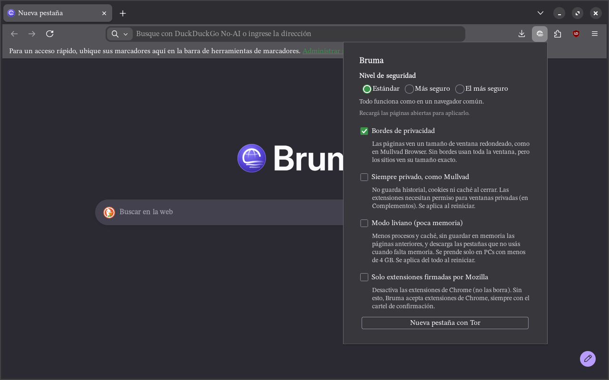
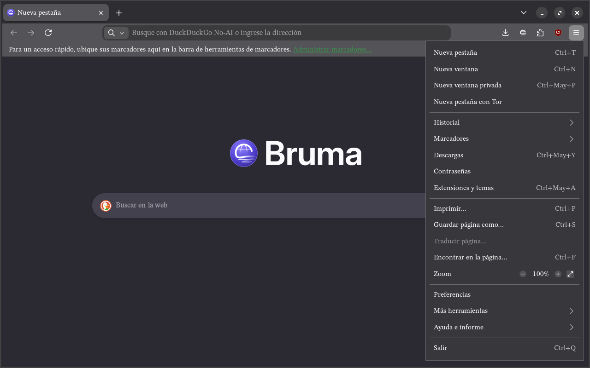
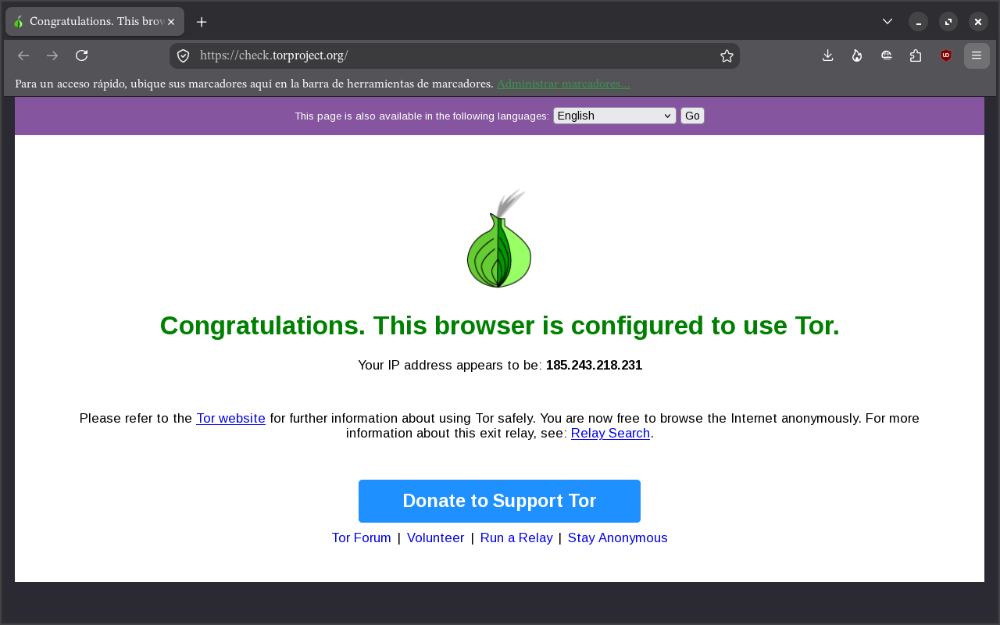

<p align="center">
  
</p>

<h1 align="center">Bruma</h1>

<p align="center">
  <b>A private web browser for NixOS.</b><br>
  LibreWolf with Mullvad Browser's protections, Chrome extensions and a built-in Tor window.
</p>

<p align="center">
  <a href="LICENSE"></a>
  
  
  
  
</p>

<p align="center">
  <b>English</b> · <a href="README.es.md">Español</a>
</p>

<p align="center">
  
</p>

---

## Highlights

| | |
|---|---|
| 🛡️ **Mullvad-level privacy** | Letterboxing, the same fonts and language as Mullvad Browser, first-party isolation, no WebGL 2, service workers or geolocation… Measured side by side with Mullvad Browser: same fingerprint except the Firefox version. |
| 🧅 **Tor in one click** | *New tab with Tor* in the ≡ menu or on any link. A separate private window with its own Tor, one circuit per site and a choice of exit country. |
| 🧩 **Firefox and Chrome extensions** | An **Add to Bruma** button in the Chrome Web Store and the Edge store, plus any `.crx` file. Extensions are adapted to Gecko automatically, their author signature is verified, and they update daily. |
| ⚙️ **Bruma button** | Security level (Standard, Safer, Safest), privacy borders, always private, light mode and signed-extensions-only, right in the toolbar. |
| 🔒 **Encrypted DNS** | DNS over HTTPS with Quad9 only, with exceptions for your local network. |
| 🪶 **Light mode** | Fewer processes and less cache for computers with little memory; turns on by itself below 4 GB of RAM. |
| 🔄 **Always up to date** | Nothing is compiled: it uses the LibreWolf build from the NixOS cache and gets Firefox security fixes with every system update. |

> Bruma is an independent project. It is not made or endorsed by Mozilla, LibreWolf,
> Mullvad or the Tor Project. Firefox, LibreWolf, Mullvad, Tor and Chrome are
> trademarks of their respective owners.

## Installation

Requires NixOS on x86_64 with a nixpkgs that provides `librewolf-unwrapped`,
`mullvad-browser` and `tor` (tested with NixOS 26.05).

1. Put this folder next to your `configuration.nix`:

   ```bash
   sudo git clone https://github.com/ebalia-real/bruma /etc/nixos/bruma
   ```

2. Import the module in `configuration.nix`:

   ```nix
   imports = [ ./bruma/modulo.nix ];
   ```

3. Apply the configuration:

   ```bash
   sudo nixos-rebuild switch
   ```

Optional settings, also in `configuration.nix`:

```nix
# Only extensions signed by Mozilla, fixed for every user (no Chrome extensions).
bruma.extensionesDeChrome = false;
# Domains resolved by the system DNS instead of encrypted DNS: your local
# network and, if you use a VPN with its own names, that VPN's domains.
bruma.dominiosLocales = [ "lan" "home" "home.arpa" "internal" "localdomain" ];
```

The interface follows the system language (`i18n.defaultLocale`); web pages see
`en-US`, like every Mullvad and Tor user.

## Using Bruma

<table>
  <tr>
    <td width="50%"></td>
    <td width="50%"></td>
  </tr>
  <tr>
    <td align="center"><sub>≡ menu → <i>New tab with Tor</i></sub></td>
    <td align="center"><sub>The Tor window, confirmed by check.torproject.org</sub></td>
  </tr>
</table>

- **Open it** from your applications menu: **Bruma**. Right-clicking its icon
  offers *New window*, *New private window* and *New private window with Tor*.
- **Bruma button** (the Bruma symbol in the toolbar) opens Bruma's own settings:
  - **Security level**: *Standard*, *Safer* or *Safest*, like Mullvad Browser;
  - **Privacy borders** (letterboxing), on or off instantly;
  - **Always private, like Mullvad**: no history, cookies or cache are kept;
  - **Light mode** for computers with little memory;
  - **Only extensions signed by Mozilla**;
  - **New tab with Tor**.
- **Tor from the ≡ menu**: *New tab with Tor*, right below *New private window*;
  and on any link, right-click → *Open link in a tab with Tor*.
- **From a terminal**: `bruma`, `bruma https://example.com`, `bruma --privada`,
  `bruma --tor`. `bruma --ayuda` lists every option.

Bruma's own labels (the Bruma button, its menu items and the terminal options)
are in Spanish for now; the rest of the browser follows your system language.

## Tor window

A separate Bruma window that reaches the internet through the Tor network:
websites see a Tor address instead of yours, and your internet provider only
sees that you use Tor. If the Tor window is already open, a new tab is added
there. It can't be a Tor tab inside a normal window: it would share cookies and
fingerprint with your other tabs.

- **Separate from your normal Bruma**: its own profile, always private (nothing
  remains when you close it), without your cookies or history.
- **Its own Tor**: started only for that window and stopped when you close the
  last one; no background service using memory. It listens on a socket that only
  your user can open. Bruma waits for Tor to connect (the first time can take a
  minute) and opens check.torproject.org to confirm it.
- **One circuit per site**, like Tor Browser: each site sees a different Tor
  address, so they can't be linked by IP.
- **Exit country** (Bruma button in that window, or `bruma --tor-pais de`):
  *Automatic* (the most anonymous) or Germany, the Netherlands, the United
  States, Sweden, Austria, France, Norway, Switzerland, Romania, Finland,
  Iceland, Denmark or Luxembourg — the countries with enough Tor exit relays.
  It applies instantly and is remembered. *New circuits* changes the address
  without changing the country. It's the closest thing to a free, account-less
  VPN with countries: with a VPN you trust a company; with Tor, that three
  volunteer relays don't collude. Choosing a country makes you a bit easier to
  tell apart than *Automatic*, and Tor is slower than a VPN.
- **Locked down**: DNS through Tor, no WebRTC or HTTP/3, privacy borders always
  on, no store extension (its converter doesn't go through Tor) and no
  extension installs.

> **It is not Tor Browser.** Websites see Bruma's fingerprint (Firefox 156 with
> *resistFingerprinting*), not Tor Browser's, which is identical for millions of
> people. It hides your IP, but if you need real anonymity (journalism, real
> danger), use Tor Browser. Some websites block Tor or show captchas.

## Privacy

Bruma starts from LibreWolf, which already brings fingerprinting resistance
(*resistFingerprinting*), strict tracking protection, uBlock Origin, HTTPS-Only
mode, Global Privacy Control, no telemetry, no Google Safe Browsing, no password
manager or DRM, and clears cookies and cache on exit.

On top of that it adds what Mullvad Browser does and LibreWolf doesn't:

| Feature | What it does |
|---|---|
| Privacy borders (*letterboxing*) | The page area is rounded to common sizes (e.g. 1200×600 instead of 1323×683); the borders you see are what's left over. Your exact window size, which helps identify you, never reaches websites. |
| Pages in English | Websites see `en-US`, like every Mullvad and Tor user; Bruma's interface stays in your language. |
| Mullvad Browser's fonts | Pages only see the fonts shipped with Mullvad Browser, with the same font for each language, not the ones on your computer. |
| Encrypted DNS (Quad9) | Your internet provider can't see which sites you visit. Quad9 also blocks malware domains. |
| First-party isolation | Cookies, cache, connections and storage are kept separate per site, as in Tor and Mullvad. |
| Smaller attack surface | No service workers, push notifications, MIDI, geolocation, WebGL 2 or SharedArrayBuffer. |
| WebRTC through relays only | The other side of a call can't see your IP, and no local or VPN addresses leak. |
| Fingerprint | Fixed storage quota, no system colors or accent color, no TLS session identifiers. |
| No calls home to Mozilla | No push, no video plugins (Widevine/OpenH264), no remote fingerprinting overrides. |
| Proxy can't be bypassed | With the Tor window or a VPN, neither extensions nor a proxy failure make it connect directly. |
| **Security level** | *Standard*: everything works. *Safer*: no JavaScript JIT or WebAssembly, some fonts and math symbols off, audio and video play on click. *Safest*: also no JavaScript, SVG, WebGL or downloaded fonts. Like Mullvad, but with Gecko preferences instead of NoScript. |
| **Always private** (optional) | What Mullvad always does: no history, cookies or cache are written to disk. |

Where Bruma is stricter than Mullvad: Firefox's tracking protection stays on
(Mullvad turns it off), certificate revocation (CRLite) stays on, and WebGL asks
for permission on each site, like LibreWolf.

<details>
<summary><b>Test results</b></summary>

Measured with Bruma opened normally (automation tools disable part of the
protection), with a Spanish interface and pages in English:

- **EFF Cover Your Tracks**: "strong protection against Web tracking"; blocks
  tracking ads and invisible trackers; randomized canvas fingerprint.
- **BrowserLeaks WebRTC**: no leak, no local IP visible (nor a VPN's).
- **BrowserLeaks JavaScript**: UTC time zone (`Atlantic/Reykjavik`), `en-US`,
  no client hints, Global Privacy Control on.
- **BrowserLeaks Canvas**: the canvas fingerprint changes every session.
- **CreepJS**: 1200×900 screen (the letterboxed one, not the real one), only 7
  detectable fonts (Mullvad's), noisy canvas, WebGL blocked until you allow it.
- **ipleak.net**: websites see Quad9's DNS servers, not your provider's.
- **Side by side with Mullvad Browser 15.0.23** (same test page in both): same
  language, time zone, core count, screen and window size, pixel ratio, visible
  fonts, font metrics, audio fingerprint, GPC, PDF viewer and storage quota, and
  neither exposes service workers, geolocation, MIDI, SharedArrayBuffer, WebGL 2
  or passkeys. Of the 246 privacy preferences where Bruma used to differ from
  Mullvad, only the intentional ones remain. Remaining differences, inherent to
  Firefox 156 versus Mullvad's 140 (no preference changes them): the Firefox
  version, touch points (5 vs 0) and the `Accept-Language` format (`q=0.9` vs
  `q=0.5`).
- **Tor window**: check.torproject.org says "Congratulations. This browser is
  configured to use Tor"; three different sites came out through three
  different Tor addresses; WebRTC doesn't exist in pages; proxy, DNS and private
  mode are locked; choosing a country moved the exit to that country (Germany,
  the Netherlands, the United States, according to the Tor directory); Tor stops
  when the last Tor window closes.

Cover Your Tracks still says "nearly unique fingerprint": that happens to every
browser with *resistFingerprinting* (Mullvad and Tor too), because few people in
its database share those values.

</details>

## Chrome and Edge extensions

- In the [Chrome Web Store](https://chromewebstore.google.com) and the
  [Edge store](https://microsoftedge.microsoft.com/addons), the store button
  reads **Add to Bruma**: click it and confirm in Firefox's install dialog. The
  "switch to Chrome/Edge" banners disappear.
- **Any `.crx` file** you download: when the download finishes, Bruma shows a
  notification; click it and confirm. A `.crx` opened from your file manager
  installs the same way.
- **From a terminal**: `bruma --extension-chrome <ID, store URL or file.crx>`.
- **Daily updates** from the store each extension came from; never to an older
  version, and never with new permissions without asking you.

Chrome and Firefox extensions share almost the same API (WebExtensions). Bruma
downloads the extension, verifies its author signature (CRX3, like Chrome),
adapts it and installs it: the Chrome background service worker becomes a Gecko
background page, missing APIs are emulated (`chrome.offscreen`,
`chrome.sidePanel`, `runtime.getContexts`, `storage.managed`…) and whatever
Gecko rejects is removed from the manifest. Tested with Dark Reader, Google
Translate, uBlock Origin Lite, Tampermonkey, Bitwarden, Return YouTube Dislike,
Xbox New Tab and Block Microsoft Login Popup.

Mozilla can't sign Chrome extensions, so Bruma accepts unsigned extensions —
always through Firefox's confirmation dialog. To accept **only Mozilla-signed
extensions**, tick that box in the Bruma button (Chrome extensions are disabled,
not deleted) or set `bruma.extensionesDeChrome = false` to lock it system-wide.

<details>
<summary><b>Security of the extension converter</b></summary>

- **Nothing installs without your confirmation.** Anything dropped into the
  profile, `~/.mozilla/extensions` or system folders stays disabled until you
  approve it, and that rule is locked.
- **Install requests** are only accepted from the two stores' pages (main frame)
  and only after a real click of yours; a page script can't click for you.
- **Native host**: only Bruma's extension can talk to it; it validates IDs and
  paths and never uses a shell.
- **Downloads**: HTTPS to each store's servers, the hash announced by the store,
  the author's CRX3 signature and a signed ID that matches the requested one.
  Huge files, zip bombs and path traversal (`..`, absolute paths) are rejected.
- **File permissions**: the profile and converted extensions live in folders only
  your user can read (700).
- **Not covered**: like in any browser, a program already running as your user
  can modify your profile; with signatures required, Firefox demands Mozilla's
  signature in that case too.

Run the converter's security tests (needs internet) from Bruma's folder:

```bash
python3 -I pruebas/seguridad.py
```

</details>

## Light mode

For computers with little memory: tick *Light mode* in the Bruma button; it turns
on by itself below 4 GB of RAM. It uses fewer processes and less cache, doesn't
keep previous pages in memory, and unloads tabs you aren't using when memory runs
low. Site isolation (Fission) stays on: it's an important security protection.

Measured with a used profile (PSS of all processes): about 710–980 MB with two
light tabs and about 1.6 GB with six heavy ones (YouTube, Reddit, news sites).
With 2 GB of RAM Bruma works well with a few tabs (better with a light desktop
such as XFCE or LXQt); with 1 GB no modern browser is comfortable.

## What Bruma can't hide

No browser is fully private. Bruma protects what happens inside the browser, but:

- **Your IP is visible** in normal windows (and with it, your provider and
  approximate city). Use the Tor window, a VPN or Tor Browser to hide it.
- **Accounts**: if you sign in somewhere, that site knows it's you.
- **Extensions**: every extension changes your fingerprint, and one with access
  to all sites can read the pages you open.
- **Automatic connections**: the Mozilla services LibreWolf keeps (block lists,
  certificate revocation, add-on updates) and, once a day, the Chrome or Edge
  store to look for updates of your Chrome extensions (they see your IP and those
  extensions' IDs; with signatures required this check doesn't run).
- **Fingerprint**: it matches Mullvad Browser except the Firefox version and two
  details that depend on it — enough for a site to tell you aren't using Mullvad
  or Tor Browser, and Bruma users are few.
- **On your computer**, history is kept (cookies and cache are cleared on exit)
  unless *Always private* is on. Private windows and the Tor window keep nothing.

## Tweaks

In `about:config`:

| To… | Set |
|---|---|
| See pages in your language (makes you easier to tell apart) | `privacy.spoof_english` → `1` |
| Use WebGL without being asked | `librewolf.webgl.prompt` → `false` |
| Use passkeys | `security.webauth.webauthn` → `true` |
| Fix calls that don't connect | `media.peerconnection.ice.relay_only` → `false` |
| Use offline web apps (service workers) | `dom.serviceWorkers.enabled` → `true` |
| Fix cross-site logins | `privacy.firstparty.isolate` → `false` |

Permanent personal settings go in a `user.js` file in `~/.local/share/bruma/gecko/`.

<details>
<summary><b>Branding and language</b></summary>

Bruma uses LibreWolf's engine, but LibreWolf doesn't show up inside the
browser: the logo, icons, new tab page, *About Bruma*, settings, help menu and
`about:support` all say Bruma. This is done at build time by replacing files
inside LibreWolf's `omni.ja` (`marca/textos.py` and `marca/codigo.py`). The
browser doesn't contact LibreWolf's servers either: uBlock Origin downloads its
filter list index from its own sources.

Mozilla's language packs say "Firefox", so the `bruma-idioma` system service
downloads the pack for your language and version, rebrands it as Bruma and
stores it in `/var/lib/bruma/idioma` (only root can modify it); a browser policy
installs it from there. Without internet Bruma opens in English and the service
retries every 10 minutes.

If a LibreWolf update changes something this relies on, the build prints a
warning (`AVISO`) without failing the system rebuild.

</details>

<details>
<summary><b>Where things are</b></summary>

| What | Where |
|---|---|
| Profile (history, extensions, settings) | `~/.local/share/bruma/gecko/` |
| Converted Chrome and Edge extensions | `~/.local/share/bruma/extensiones-chrome/` |
| Tor window profile (always private) | `~/.local/share/bruma/tor/` |
| Tor data and log | `~/.local/share/bruma/tor-red/` |
| Tor sockets (SOCKS and control) | `/run/user/<uid>/bruma-tor/` (your user only) |

| File | Purpose |
|---|---|
| `modulo.nix` | NixOS module: installs Bruma, the language service, the extension update timer and the GNOME menu refresh. |
| `default.nix` | The package: LibreWolf + settings, Mullvad's fonts, Bruma's own extension and launcher. |
| `gecko/ajustes.cfg` | Mullvad Browser's settings added on top of LibreWolf's. |
| `lanzador.sh` | The `bruma` command (Tor window included). |
| `extension/` | Bruma's extension: the store buttons and `.crx` installs. |
| `host/` | Native host and converter for Chrome extensions, compatibility layer, Tor exit-country helper. |
| `marca/` | Branding, the Bruma button (`ajustes-bruma.sys.mjs`) and the scripts that apply them. |
| `iconos/` | The logo: a globe (the web) dissolving into wisps of mist. |
| `pruebas/seguridad.py` | Security tests of the extension converter. |

</details>

## FAQ

**Why not just use Mullvad Browser?** Its protection relies on every user being
identical, and any extension breaks that. In nixpkgs it also tends to lag behind
on security fixes.

**Why not a Chromium engine?** There's no engine that mixes Gecko and Chromium.
Bruma uses one engine (Gecko) and adapts Chrome extensions, which almost always
work.

**Is it fully anonymous?** No browser is. See [What Bruma can't hide](#what-bruma-cant-hide).

## License

Bruma is released under the [Mozilla Public License 2.0](LICENSE) (MPL-2.0), the
same family of licenses as Firefox and LibreWolf.
